<div align="center">


# ARPY Copiler

### Arduino + Python + AI — all in one desktop IDE

Program your board, build the Python app that talks to it, and let an AI that knows your **entire project** write, fix and explain the code.

[](https://github.com/SrJayYT/ARPY-APP/releases/latest)
[](https://github.com/SrJayYT/ARPY-APP/actions)


[](LICENSE)

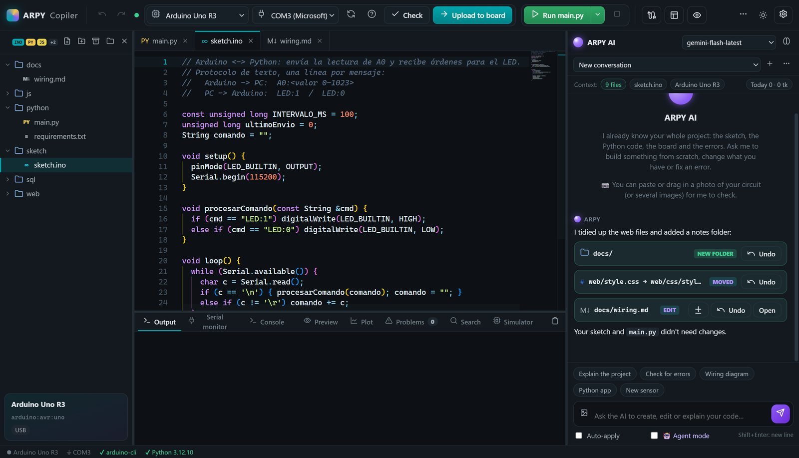

**[🇬🇧 English documentation](#-english)** &nbsp;·&nbsp; **[🇪🇸 Documentación en español](#-español)** &nbsp;·&nbsp; **[⬇ Download](https://github.com/SrJayYT/ARPY-APP/releases/latest)**

</div>

---

## Overview · Resumen

| | |
|---|---|
| **What it is** · *Qué es* | A Windows desktop IDE that unifies **Arduino** development, **Python** desktop/web apps and an **AI assistant** (Google Gemini) in one project. · *Un IDE de escritorio que une Arduino, apps de Python y un asistente de IA en un solo proyecto.* |
| **Who it's for** · *Para quién* | Students, makers and teachers who build hardware projects with a computer-side app. · *Estudiantes, makers y docentes que hacen proyectos con hardware y una app en el PC.* |
| **Why** · *Por qué* | No more juggling Arduino IDE + a Python editor + an AI chat you have to paste code into. · *Se acabó saltar entre Arduino IDE, otro editor y un chat de IA al que hay que copiarle el código.* |
| **Languages** · *Idiomas* | Interface in English (default) or Spanish. · *Interfaz en inglés (por defecto) o español.* |

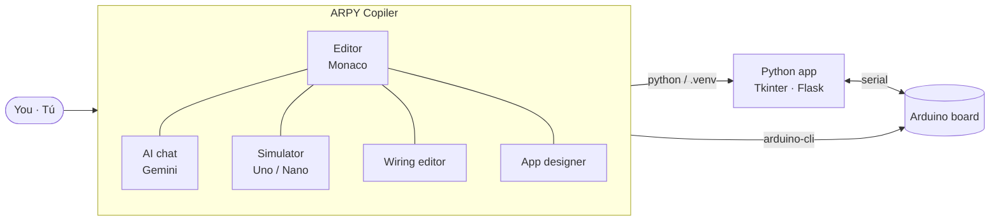

---

<br/>

# 🇬🇧 English

## Table of contents

1. [Features](#features)
2. [Screenshots](#screenshots)
3. [Getting started](#getting-started)
4. [How the AI works](#how-the-ai-works)
5. [`.arpy` projects](#arpy-projects)
6. [Examples](#examples)
7. [System requirements & performance](#system-requirements--performance)
8. [Keyboard shortcuts](#keyboard-shortcuts)
9. [Architecture](#architecture)
10. [Development](#development)
11. [FAQ](#faq)
12. [License](#license)

## Features

<table>
<tr><td width="50%" valign="top">

**🤖 AI assistant**
- Sees the **whole project** in every message: sketch, Python, board, wiring, compiler/serial/Python output.
- **Live edits**: removed lines in **red**, added lines in **green** while it types; then *Apply* or *Discard*.
- **Agent mode**: applies, compiles, reads errors and fixes itself (up to 3 rounds).
- **Images**: up to 10 per message. Circuit photos, error screenshots, datasheets, UI sketches.
- **Project memory** plus separate **conversations per project**.
- Pauses when offline and resumes on its own when the connection returns.

</td><td width="50%" valign="top">

**🔌 Arduino**
- From **Uno R3 / Nano / Mega** to **UNO R4 WiFi, Nano ESP32, GIGA, Portenta, UNO Q**.
- Official **arduino-cli**, downloaded automatically. Upload over **USB or WiFi (OTA)**.
- **Board detection** on plug-in. **Driver helper** (CH340 one-click, CP210x, FTDI).
- **Visual wiring editor**: place parts on the board and let the AI write the sketch.
- **Simulator** (Uno/Nano) with interactive parts: LEDs, buttons, pots, servos.
- **Multi-board serial monitor**, HEX view, CSV export, live plot.

</td></tr>
<tr><td valign="top">

**🐍 Python**
- Per-project **virtual environment**, created automatically.
- **Python-only projects**: turn Arduino off and the board tools are hidden.
- **Drag-and-drop app designer** that generates Tkinter apps (4 styles).
- Debugger, **build .exe** (PyInstaller), run on **UNO Q / Raspberry Pi** over SSH.
- Installs Python for you if it's missing.

</td><td valign="top">

**🧰 Workspace**
- Monaco editor (the editor behind VS Code), search & replace, quick open.
- **Version history** with git: save, compare and restore.
- **Export / import** projects as `.zip`.
- **Auto-updates** from GitHub Releases. First-run **setup wizard**.
- Light/dark theme. **Lite mode** for 8 GB laptops.

</td></tr>
</table>

## Screenshots

| Live AI edits | Wiring editor |
|---|---|
| 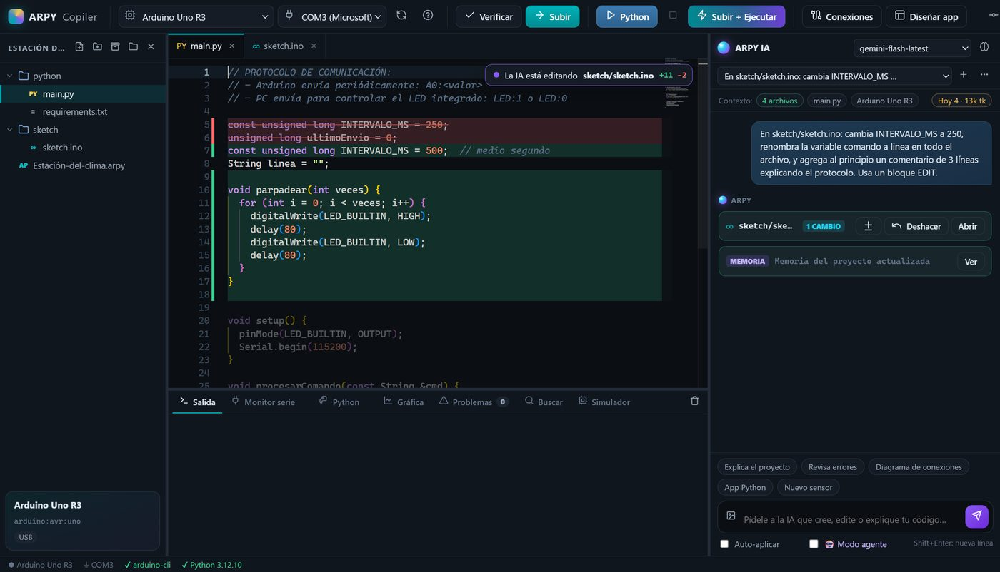 | 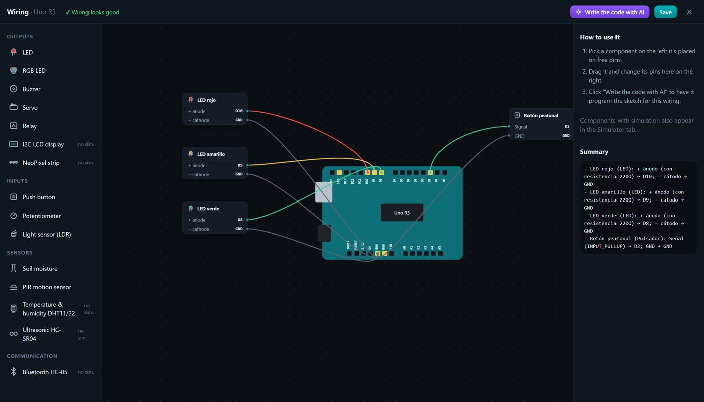 |
| **Simulator with components** | **Examples gallery** |
| 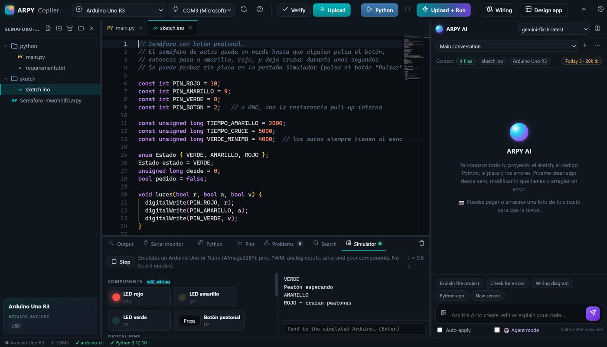 | 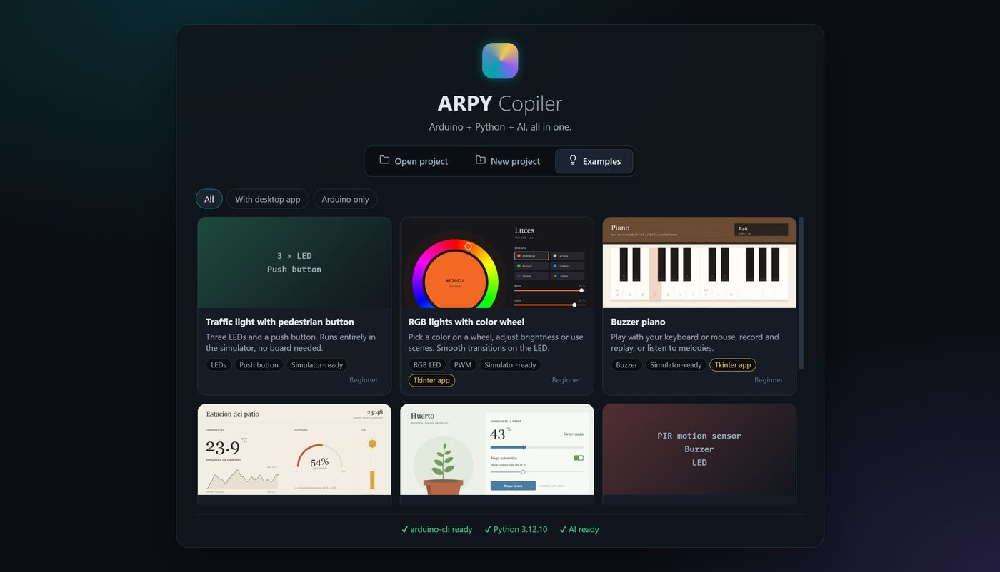 |

## Getting started

1. Download from **[Releases](https://github.com/SrJayYT/ARPY-APP/releases/latest)**:
   - `ARPY Copiler Setup x.y.z.exe`: installer with shortcuts; also associates `.arpy` files with the app.
   - `ARPY Copiler Portable x.y.z.exe`: no installation, just double-click.
2. Windows SmartScreen will say *"Windows protected your PC"* because the app isn't code-signed. Click **More info → Run anyway**.
3. The **setup wizard** guides you through four steps:
   1. pick a language;
   2. paste your free Gemini API key from [aistudio.google.com/apikey](https://aistudio.google.com/apikey);
   3. detect your board;
   4. blink its LED as a test.
4. Create a project, open one, or start from an **example**.

> [!TIP]
> **Board not showing up?** Click the **?** next to the port selector. Clone boards usually need the **CH340** driver, which the app installs in one click.

## How the AI works

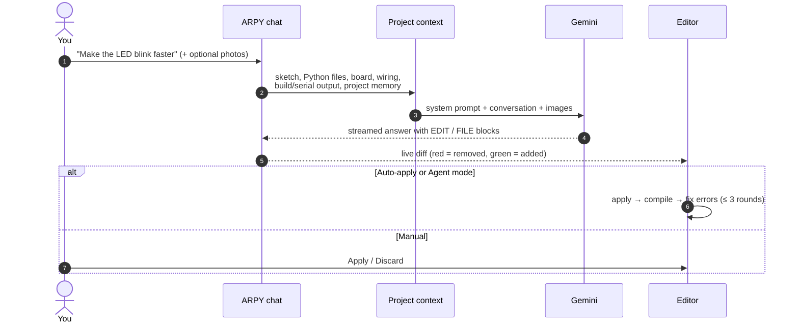

- The AI **never starts from zero**. It continues the current conversation and already knows every file.
- It edits with **search/replace blocks**, so only the lines that need changing are touched. Every change can be **undone**.
- It replies in the language you write in.

## `.arpy` projects

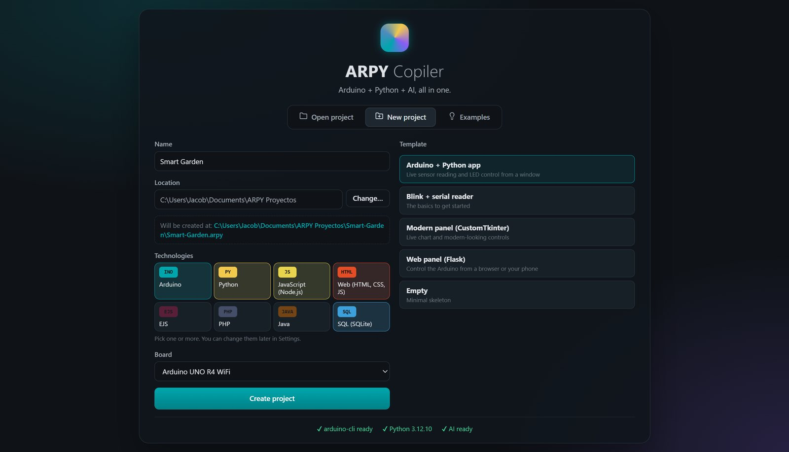

Every project is a folder with a **`<name>.arpy`** file. Open it in any of these ways:
- by double-clicking the file;
- with **Open project…**;
- by dragging the file onto the window.

```
Weather-station/
├── Weather-station.arpy   ← project settings (board, port, baud, Arduino on/off)
├── sketch/sketch.ino      ← Arduino code (absent in Python-only projects)
├── python/main.py         ← your Python app
├── python/requirements.txt
├── .venv/                 ← Python environment (automatic)
└── .arpy/                 ← conversations, AI memory, wiring, UI designs, backups
```

Conversations and memory are stored **inside each project**, so closing a project or opening another never mixes them.

## Examples

| Example | Hardware | Desktop app | Simulator |
|---|---|:-:|:-:|
| Traffic light with pedestrian button | 3 LEDs, push button | — | ✅ |
| Motion-sensor alarm | PIR, buzzer, LED | — | ✅ |
| Ultrasonic radar | Servo, HC-SR04 | — | — |
| Bluetooth control | HC-05, relay, LED | — | — |
| **Weather station** | DHT11, LDR | ✅ Tkinter | — |
| **Garden with automatic watering** | Soil sensor, relay | ✅ Tkinter | — |
| **RGB lights with color wheel** | RGB LED | ✅ Tkinter | ✅ |
| **Buzzer piano** | Passive buzzer, LED | ✅ Tkinter | ✅ |

All sketches compile for the Arduino Uno. The desktop apps run without a board, using sample data.

## System requirements & performance

| | Minimum | Recommended |
|---|---|---|
| OS | Windows 10 64-bit | Windows 11 |
| RAM | 8 GB (even DDR3) | 16 GB |
| Disk | ~600 MB + board cores | SSD |
| Internet | First run (arduino-cli, cores) and for the AI | — |

On machines with **≤ 8 GB RAM or ≤ 4 cores**, **lite mode** turns on automatically. It renders without the GPU, hides the minimap and reduces animations. Measured memory with a project open:

| Mode | Private memory |
|---|---|
| Lite | **~220 MB** |
| Full | ~420–550 MB |

## Keyboard shortcuts

| Shortcut | Action |
|---|---|
| `Ctrl+R` / `Ctrl+U` | Verify / Upload |
| `F5` / `Shift+F5` | Run / Stop Python |
| `Ctrl+F5` | Upload + Run |
| `F9` | Debug Python |
| `Ctrl+K` | Ask the AI about the selection |
| `Ctrl+L` | Focus the chat |
| `Ctrl+P` | Quick open |
| `Ctrl+Shift+F` | Search in project |
| `Ctrl+Shift+S` | Save version |

## Architecture

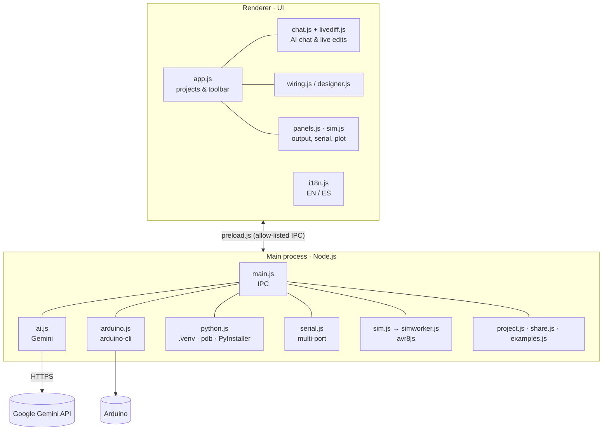

| Folder | Contents |
|---|---|
| `src/main/` | Electron main process: IPC, arduino-cli, Python, serial, AI, simulator, projects, updater |
| `src/renderer/` | UI: editor, chat, live diff, panels, wiring editor, designer, wizard, i18n |
| `src/shared/` | Board catalog, parts catalog, Tkinter code generator, English dictionary |
| `src/examples/` | The 8 ready-made examples (sketch, app, wiring, preview) |
| `test/` | Automated tests (`node --test`) |

## Development

Requirements: **Node.js 22+**, Windows 10/11. Python 3 is optional (some tests use it).

```bash
git clone https://github.com/SrJayYT/ARPY-APP.git
cd ARPY-APP
npm install
npm start          # run in development mode
npm test           # automated tests (also run on GitHub Actions)
npm run dist       # build installer + portable into dist/
```

> [!IMPORTANT]
> Public builds **don't include an API key**: each user adds their own. For a private build with a built-in key, create `src/main/secret.js` exporting a function that returns the key (the file is in `.gitignore`). **Never publish executables that contain your key.**

## FAQ

<details><summary><b>Do I need an Arduino to try it?</b></summary>

No. Use the **simulator** (Uno/Nano), or create a **Python-only** project by switching Arduino off when you create it.
</details>

<details><summary><b>Is the AI free?</b></summary>

Gemini has a free daily quota that's enough for normal use. The app shows today's usage, and if one model is busy it switches to a backup model automatically.
</details>

<details><summary><b>Does it work on macOS or Linux?</b></summary>

It's built with Electron, but only Windows is tested and packaged right now.
</details>

## License

[MIT](LICENSE) © DevPapo

<p align="right"><a href="#arpy-copiler">↑ Back to top</a></p>

---

<br/>

# 🇪🇸 Español

## Índice

1. [Funciones](#funciones)
2. [Capturas](#capturas)
3. [Primeros pasos](#primeros-pasos)
4. [Cómo trabaja la IA](#cómo-trabaja-la-ia)
5. [Proyectos `.arpy`](#proyectos-arpy)
6. [Ejemplos](#ejemplos)
7. [Requisitos y rendimiento](#requisitos-y-rendimiento)
8. [Atajos de teclado](#atajos-de-teclado)
9. [Arquitectura](#arquitectura)
10. [Desarrollo](#desarrollo)
11. [Preguntas frecuentes](#preguntas-frecuentes)
12. [Licencia](#licencia)

## Funciones

<table>
<tr><td width="50%" valign="top">

**🤖 Asistente de IA**
- Ve **todo el proyecto** en cada mensaje: sketch, Python, placa, conexiones y la salida de compilación, del monitor serie y de Python.
- **Ediciones en vivo**: mientras escribe, en **rojo** lo que quita y en **verde** lo que pone. Luego *Aplicar* o *Descartar*.
- **Modo agente**: aplica, compila, lee los errores y se corrige sola (hasta 3 intentos).
- **Imágenes**: hasta 10 por mensaje. Fotos del circuito, capturas de errores, hojas de datos, bocetos de interfaz.
- **Memoria del proyecto** y **conversaciones separadas por proyecto**.
- Sin internet se pausa y vuelve sola cuando regresa la conexión.

</td><td width="50%" valign="top">

**🔌 Arduino**
- Desde **Uno R3 / Nano / Mega** hasta **UNO R4 WiFi, Nano ESP32, GIGA, Portenta, UNO Q**.
- **arduino-cli** oficial, se descarga solo. Subida por **USB o WiFi (OTA)**.
- **Detecta la placa** al enchufarla. **Ayuda con drivers** (CH340 con un clic, CP210x, FTDI).
- **Editor visual de conexiones**: coloca componentes en la placa y la IA escribe el sketch.
- **Simulador** (Uno/Nano) con componentes interactivos: LEDs, pulsadores, potenciómetros, servos.
- **Monitor serie con varias placas**, vista HEX, exportar CSV, gráfica en vivo.

</td></tr>
<tr><td valign="top">

**🐍 Python**
- **Entorno virtual** por proyecto, automático.
- **Proyectos solo de Python**: si desactivas Arduino, se ocultan las herramientas de la placa.
- **Diseñador de apps** arrastrando controles: genera apps Tkinter (4 estilos).
- Depurador, **crear .exe** (PyInstaller), ejecutar en **UNO Q / Raspberry Pi** por SSH.
- Si falta Python, la app lo instala.

</td><td valign="top">

**🧰 Espacio de trabajo**
- Editor Monaco (el de VS Code), buscar y reemplazar, apertura rápida.
- **Historial de versiones** con git: guardar, comparar, restaurar.
- **Exportar / importar** proyectos en `.zip`.
- **Actualizaciones automáticas** desde GitHub. **Asistente de primer uso**.
- Tema claro/oscuro. **Modo ligero** para laptops de 8 GB.

</td></tr>
</table>

## Capturas

| La IA editando en vivo | Editor de conexiones |
|---|---|
|  |  |
| **Simulador con componentes** | **Galería de ejemplos** |
|  |  |

## Primeros pasos

1. Descarga desde **[Releases](https://github.com/SrJayYT/ARPY-APP/releases/latest)**:
   - `ARPY Copiler Setup x.y.z.exe`: instalador con accesos directos; asocia los archivos `.arpy` a la app.
   - `ARPY Copiler Portable x.y.z.exe`: no se instala, se abre con doble clic.
2. Windows mostrará *"Windows protegió su PC"* porque la app no tiene firma digital. Pulsa **Más información → Ejecutar de todas formas**.
3. El **asistente de primer uso** te guía en cuatro pasos:
   1. elegir el idioma;
   2. pegar tu API key gratis de Gemini ([aistudio.google.com/apikey](https://aistudio.google.com/apikey));
   3. detectar tu placa;
   4. hacer parpadear su LED como prueba.
4. Crea un proyecto, abre uno o empieza con un **ejemplo**.

> [!TIP]
> **¿No aparece la placa?** Pulsa el **?** junto al selector de puerto. Las placas clon suelen necesitar el driver **CH340**, que la app instala con un clic.

## Cómo trabaja la IA

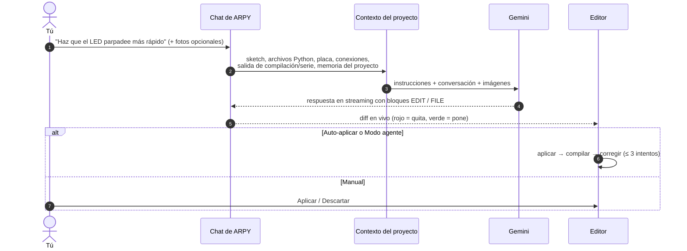

- La IA **nunca empieza de cero**: sigue la conversación actual y ya conoce cada archivo.
- Edita con **bloques buscar/reemplazar**, así que solo toca las líneas necesarias. Cada cambio se puede **deshacer**.
- Responde en el idioma en que le escribes.

## Proyectos `.arpy`

Cada proyecto es una carpeta con un archivo **`<nombre>.arpy`**. Se abre de cualquiera de estas formas:
- con doble clic en el archivo;
- con **Abrir proyecto…**;
- arrastrando el archivo a la ventana.

```
Estacion-del-clima/
├── Estacion-del-clima.arpy   ← configuración (placa, puerto, baudios, Arduino sí/no)
├── sketch/sketch.ino         ← código de Arduino (no existe en proyectos solo de Python)
├── python/main.py            ← tu app de Python
├── python/requirements.txt
├── .venv/                    ← entorno de Python (automático)
└── .arpy/                    ← conversaciones, memoria de la IA, conexiones, diseños, copias
```

Las conversaciones y la memoria se guardan **dentro de cada proyecto**: cerrar uno o abrir otro nunca las mezcla.

## Ejemplos

| Ejemplo | Hardware | App de escritorio | Simulador |
|---|---|:-:|:-:|
| Semáforo con botón peatonal | 3 LEDs, pulsador | — | ✅ |
| Alarma con sensor de movimiento | PIR, zumbador, LED | — | ✅ |
| Radar ultrasónico | Servo, HC-SR04 | — | — |
| Control por Bluetooth | HC-05, relé, LED | — | — |
| **Estación del clima** | DHT11, LDR | ✅ Tkinter | — |
| **Huerto con riego automático** | Sensor de suelo, relé | ✅ Tkinter | — |
| **Luces RGB con rueda de color** | LED RGB | ✅ Tkinter | ✅ |
| **Piano con zumbador** | Zumbador pasivo, LED | ✅ Tkinter | ✅ |

Todos los sketches compilan para Arduino Uno. Las apps de escritorio funcionan sin placa, con datos de ejemplo.

## Requisitos y rendimiento

| | Mínimo | Recomendado |
|---|---|---|
| Sistema | Windows 10 de 64 bits | Windows 11 |
| RAM | 8 GB (incluso DDR3) | 16 GB |
| Disco | ~600 MB + soporte de placas | SSD |
| Internet | La primera vez (arduino-cli, placas) y para la IA | — |

En equipos con **8 GB de RAM o menos, o con 4 núcleos o menos**, el **modo ligero** se activa solo. Dibuja sin GPU, oculta el minimapa y reduce las animaciones. Memoria medida con un proyecto abierto:

| Modo | Memoria privada |
|---|---|
| Ligero | **~220 MB** |
| Completo | ~420–550 MB |

## Atajos de teclado

| Atajo | Acción |
|---|---|
| `Ctrl+R` / `Ctrl+U` | Verificar / Subir |
| `F5` / `Shift+F5` | Ejecutar / Detener Python |
| `Ctrl+F5` | Subir + Ejecutar |
| `F9` | Depurar Python |
| `Ctrl+K` | Preguntar a la IA sobre la selección |
| `Ctrl+L` | Ir al chat |
| `Ctrl+P` | Abrir archivo rápido |
| `Ctrl+Shift+F` | Buscar en el proyecto |
| `Ctrl+Shift+S` | Guardar versión |

## Arquitectura

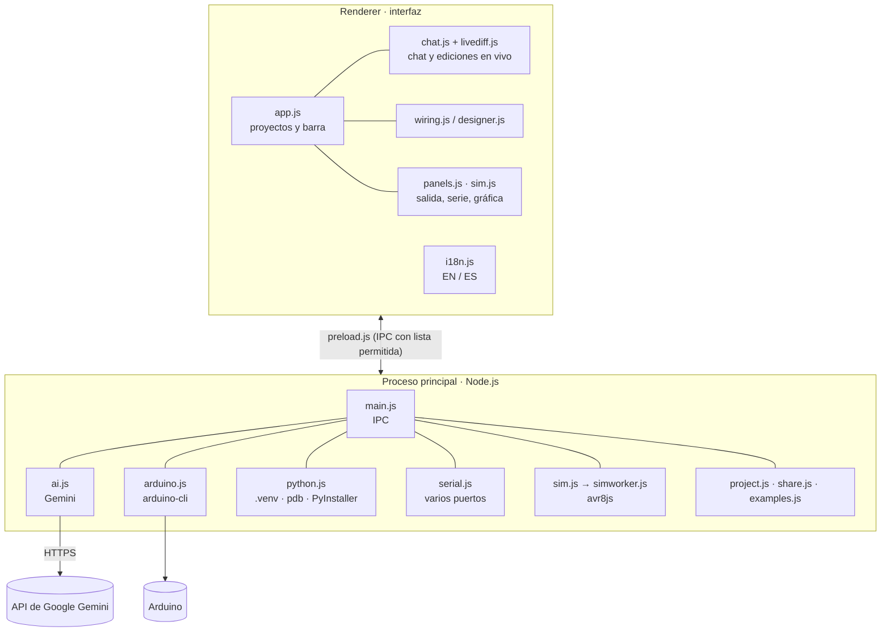

| Carpeta | Contenido |
|---|---|
| `src/main/` | Proceso principal de Electron: IPC, arduino-cli, Python, serie, IA, simulador, proyectos, actualizaciones |
| `src/renderer/` | Interfaz: editor, chat, diff en vivo, paneles, conexiones, diseñador, asistente, idiomas |
| `src/shared/` | Catálogo de placas y componentes, generador de código Tkinter, diccionario de inglés |
| `src/examples/` | Los 8 ejemplos (sketch, app, conexiones, vista previa) |
| `test/` | Pruebas automáticas (`node --test`) |

## Desarrollo

Requisitos: **Node.js 22+** y Windows 10/11. Python 3 es opcional (lo usan algunas pruebas).

```bash
git clone https://github.com/SrJayYT/ARPY-APP.git
cd ARPY-APP
npm install
npm start          # modo desarrollo
npm test           # pruebas automáticas (también en GitHub Actions)
npm run dist       # instalador + portable en dist/
```

> [!IMPORTANT]
> Las compilaciones públicas **no traen API key**: cada persona usa la suya. Para una compilación privada con la key incluida, crea `src/main/secret.js`, que exporte una función que devuelva la key (está en `.gitignore`). **Nunca publiques ejecutables con tu key.**

## Preguntas frecuentes

<details><summary><b>¿Necesito un Arduino para probarla?</b></summary>

No. Usa el **simulador** (Uno/Nano), o crea un proyecto **solo de Python** desactivando Arduino al crearlo.
</details>

<details><summary><b>¿La IA es gratis?</b></summary>

Gemini tiene una cuota diaria gratuita que alcanza para el uso normal. La app muestra el uso del día y, si un modelo está saturado, cambia sola a uno de respaldo.
</details>

<details><summary><b>¿Funciona en macOS o Linux?</b></summary>

Está hecha con Electron, pero por ahora solo se prueba y se empaqueta para Windows.
</details>

## Licencia

[MIT](LICENSE) © DevPapo

<p align="right"><a href="#arpy-copiler">↑ Volver arriba</a></p>
