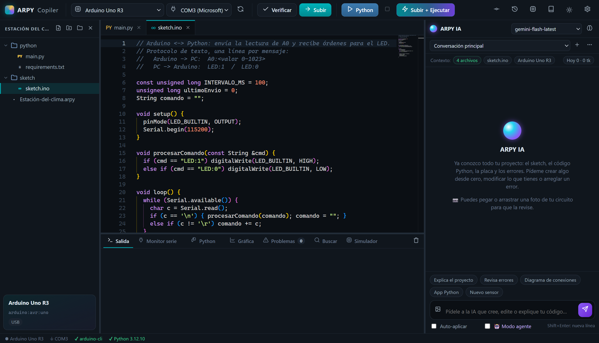
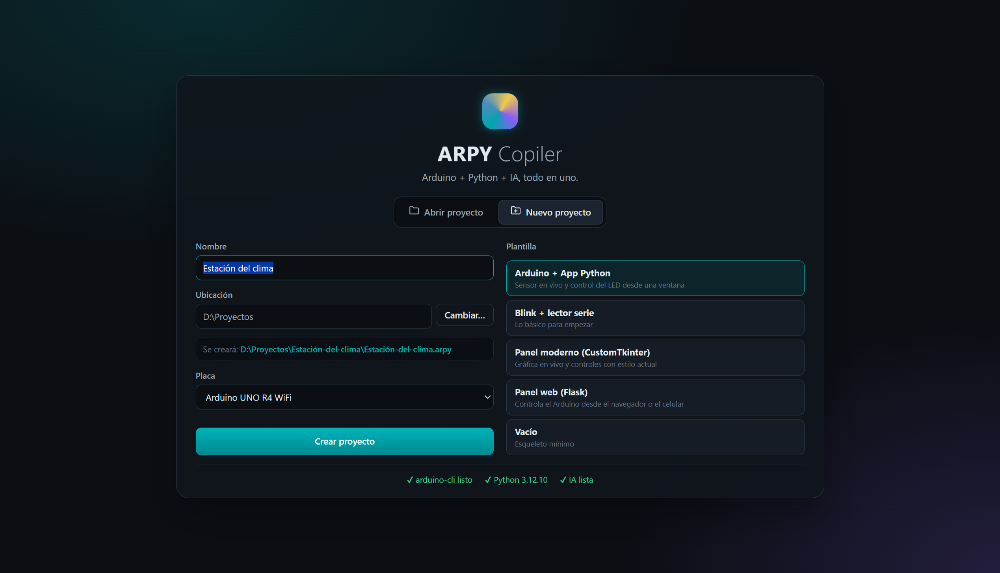

<div align="center">


# ARPY Copiler

**IDE de escritorio todo en uno para Arduino + Python, con IA integrada.**

Programa tu placa, crea la app de Python que habla con ella y deja que la IA escriba, corrija y explique el código del proyecto completo, sin cambiar de programa.

[**⬇ Descargar para Windows**](https://github.com/SrJayYT/ARPY-APP/releases/latest) · [Funciones](#funciones) · [Primeros pasos](#primeros-pasos) · [Desarrollo](#desarrollo)



</div>

---

## ¿Por qué?

Normalmente un proyecto con Arduino que tiene una interfaz necesita **Arduino IDE** para la placa, **otro editor** para la app de Python y un **chat de IA aparte** al que hay que copiarle el código cada vez. ARPY Copiler junta las tres cosas en un solo proyecto.

La IA **ve el proyecto entero en cada mensaje**: el sketch, los scripts Python, la placa elegida, los errores de compilación, la salida de Python y el monitor serie. Nunca empieza de cero con un "Hola, ¿en qué te ayudo?".

## Funciones

### 🤖 IA (Google Gemini)
- **Contexto completo del proyecto** y **memoria del proyecto** que se recuerda entre conversaciones.
- Varias **conversaciones por proyecto**, guardadas junto al proyecto.
- **Crea o edita archivos**: muestra el diff y tú decides si aplicar o deshacer. Las ediciones parciales solo tocan las líneas necesarias.
- **Modo agente**: aplica los cambios, compila, lee los errores y se corrige sola (hasta 3 intentos).
- **Fotos del circuito**: pega, arrastra o adjunta una imagen y la IA revisa tus conexiones.
- **Diagramas de conexiones**, autocompletado opcional en el editor y `Ctrl+K` para pedir cambios sobre lo que tengas seleccionado.
- Si un modelo está saturado, cambia solo a otro modelo de respaldo.

### 🔌 Arduino
- Placas desde el **Uno R3 / Nano / Mega** hasta las modernas: **UNO R4 WiFi**, **Nano ESP32**, **GIGA R1**, **Portenta**, **UNO Q**, entre otras.
- Usa el **arduino-cli** oficial, que se descarga solo. El soporte de cada placa se instala la primera vez que compilas.
- Gestor de **placas** y **librerías**. Subida por USB o **por WiFi (OTA)**.
- **Simulador de Arduino Uno** sin placa: pines, PWM, entradas analógicas con deslizadores y puerto serie.
- Información de cada pin al pasar el mouse (PWM, I2C, SPI, voltaje).
- **Monitor serie** con vista HEX, exportación a CSV y **gráfica en vivo**.

### 🐍 Python
- **Entorno virtual por proyecto** (`.venv`), que se crea solo e instala `requirements.txt`.
- Si el equipo no tiene Python, **la app lo instala** (sin permisos de administrador).
- El puerto y los baudios de la placa llegan al script como variables `ARPY_PORT` y `ARPY_BAUD`.
- **Depurador** con puntos de parada, **crear .exe** con PyInstaller y **ejecutar en la placa** (UNO Q / Raspberry Pi) por SSH.
- Plantillas: Tkinter, **CustomTkinter** moderno y **panel web con Flask** (se controla desde el celular).

### 📝 Editor
- Editor Monaco (el de VS Code) con resaltado de sintaxis para Arduino y Python.
- Búsqueda en todo el proyecto, apertura rápida de archivos e **historial de versiones** con git (guardar, comparar y restaurar).
- Tema oscuro y claro.

## Primeros pasos

1. Descarga desde [**Releases**](https://github.com/SrJayYT/ARPY-APP/releases/latest) una de estas opciones:
   - **`ARPY Copiler Setup 1.0.0.exe`**: instalador con accesos directos. Además asocia los archivos `.arpy` a la app.
   - **`ARPY Copiler Portable 1.0.0.exe`**: no se instala, se abre con doble clic.
2. Windows mostrará *"Windows protegió su PC"* porque la app no tiene firma digital. Pulsa **Más información → Ejecutar de todas formas**.
3. La primera vez se necesita internet: **arduino-cli se descarga solo**.
4. **Pon tu API key de Gemini (gratis):**
   1. Entra en [aistudio.google.com/apikey](https://aistudio.google.com/apikey) y crea una key.
   2. En la app, abre ⚙ **Configuración**, pega la key y guarda.
5. Crea un proyecto nuevo o abre uno existente.

> **¿La placa no aparece en los puertos?** Las placas clon con chip **CH340** necesitan instalar el driver CH340. Las placas originales de Arduino no lo necesitan.

## Proyectos `.arpy`



Cada proyecto es una carpeta con un archivo **`<nombre>.arpy`**. Así se abre un proyecto:
- doble clic en el archivo `.arpy` (si usaste el instalador);
- **Abrir proyecto…** en el menú principal;
- arrastrando el archivo `.arpy` a la ventana de la app.

El menú principal también lista los proyectos en los que trabajaste hace poco. Con **Importar carpeta…** conviertes en proyecto un sketch de Arduino IDE o una carpeta con scripts Python.

```
Estación-del-clima/
├── Estación-del-clima.arpy   ← archivo del proyecto (placa, puerto, baudios…)
├── sketch/sketch.ino         ← código del Arduino
├── python/main.py            ← tu app Python
├── python/requirements.txt
├── .venv/                    ← entorno Python (automático)
└── .arpy/                    ← conversaciones, memoria de la IA y copias de seguridad
```

## Atajos

| Atajo | Acción |
|---|---|
| `Ctrl+R` / `Ctrl+U` | Verificar / Subir a la placa |
| `F5` / `Shift+F5` | Ejecutar / Detener Python |
| `Ctrl+F5` | Subir + Ejecutar |
| `F9` | Depurar Python |
| `Ctrl+K` | Pedir a la IA sobre la selección |
| `Ctrl+L` | Ir al chat |
| `Ctrl+P` | Abrir archivo rápido |
| `Ctrl+Shift+F` | Buscar en el proyecto |
| `Ctrl+Shift+S` | Guardar versión |

## Desarrollo

Requisitos: **Node.js 20+** y Windows 10/11 (macOS y Linux sin probar).

```bash
git clone https://github.com/SrJayYT/ARPY-APP.git
cd ARPY-APP
npm install
npm start          # abrir en modo desarrollo
npm run dist       # crear instalador y portable en dist/
```

**API key integrada (opcional).** Las compilaciones públicas no traen key: cada persona usa la suya desde Configuración. Si quieres una compilación privada con la key incluida, crea `src/main/secret.js`, que exporte una función que devuelva la key. Ese archivo está en `.gitignore`. **No publiques ejecutables con tu key**: cualquiera podría extraerla.

### Estructura

```
src/
├── main/         proceso principal de Electron (arduino-cli, Python, serie, IA, proyectos, simulador)
├── renderer/     interfaz (editor Monaco, chat, paneles, simulador)
└── shared/       catálogo de placas
```

Tecnologías: Electron · Monaco Editor · arduino-cli · serialport · avr8js · Google Gemini API.

## Licencia

[MIT](LICENSE) © DevPapo
